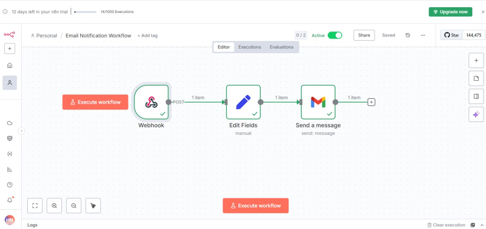
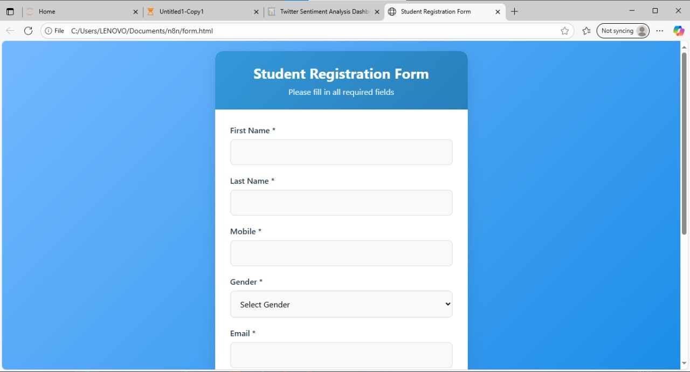
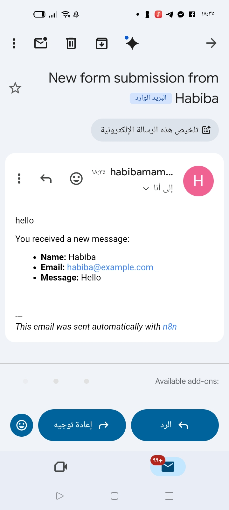

# 1. Email Notification

A Student Registration form (`form.html`) sends its data to an n8n webhook, and the workflow emails me the details of each submission.

## Flow

`Webhook` → `Edit Fields` → `Gmail`

- **Webhook**: POST request on the path `form-submission`. Responds immediately.
- **Edit Fields**: maps first name, last name, mobile, gender, email, governorate and date of birth from the request body.
- **Gmail**: sends an HTML email with subject "New form submission" containing all the fields.

## Files

- `workflow.json` - the n8n workflow
- `form.html` - the registration form (plain HTML, CSS and JavaScript)

## Setup

1. Import `workflow.json` and connect a Gmail account.
2. Put your email in the **To** field (`YOUR_EMAIL@gmail.com`).
3. In `form.html`, check the `WEBHOOK_URL` line near the bottom and make it match your n8n address.
4. For testing, click **Listen for test event** on the Webhook node and then submit the form. The test URL (`/webhook-test/...`) only accepts one request each time you click it. Once the workflow is active, use the production URL (`/webhook/...`).

The webhook has "Allowed Origins" set to `*` so the form works when opened directly from a file.

## Screenshots

| Form | Received email |
|------|----------------|
|  |  |

Node settings: [Webhook](screenshots/webhook-node.png), [Edit Fields](screenshots/edit-fields-node.png), [Gmail](screenshots/gmail-node.png)
