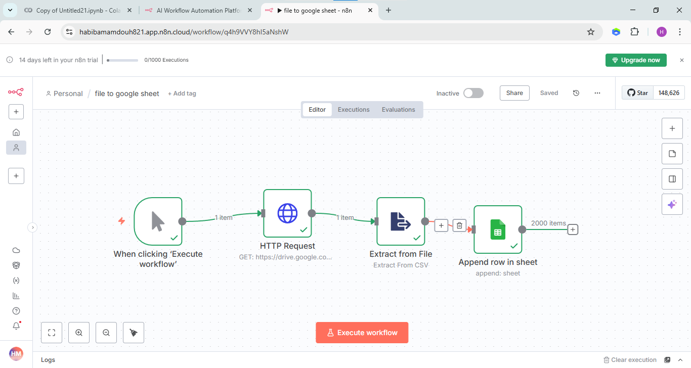
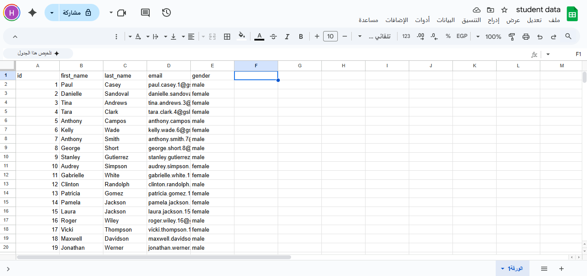

# 2. File to Google Sheets

Downloads a CSV file (`student-scores.csv`, 2000 rows) from Google Drive and appends the rows to a Google Sheet called "student data".

## Flow

`Manual Trigger` → `HTTP Request` → `Extract from File` → `Google Sheets`

- **HTTP Request**: GET request to the Google Drive download link of the file.
- **Extract from File**: operation "Extract From CSV", reads the binary field `data`. Gives 2000 items.
- **Google Sheets**: operation "Append Row". I mapped the columns manually: `id`, `first_name`, `last_name`, `email`, `gender`.

## Setup

1. Import `workflow.json` and connect a Google Sheets account.
2. In the HTTP Request node replace `YOUR_DRIVE_FILE_ID` with the ID of your file. The file must be shared as "Anyone with the link", otherwise n8n can't download it. The ID is the part of the share link between `/d/` and `/view`.
3. In the Google Sheets node choose your own spreadsheet (`YOUR_GOOGLE_SHEET_ID`) and sheet. The first row of the sheet should have the column names above.
4. Click **Execute workflow**.

## Screenshots

Node settings: [HTTP Request](screenshots/http-request-node.png), [Extract from File](screenshots/extract-from-file-node.png), [Google Sheets](screenshots/google-sheets-node.png)
