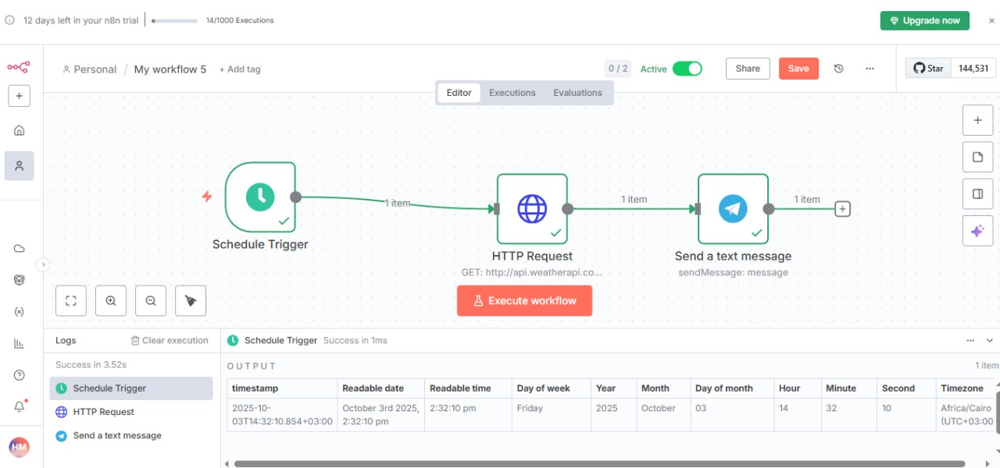
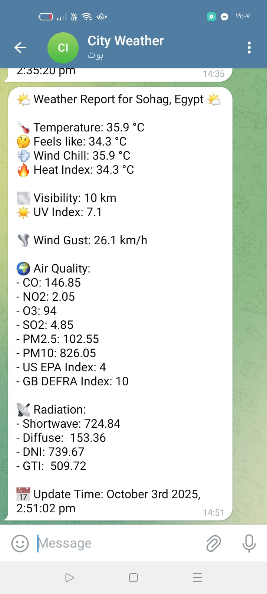

# 3. Daily Weather Update

Every day at 7:00 AM (Cairo time) the workflow gets the current weather for Sohag from WeatherAPI and sends it to me on Telegram.

## Flow

`Schedule Trigger` → `HTTP Request` → `Telegram`

- **Schedule Trigger**: every 1 day at 7am.
- **HTTP Request**: GET `http://api.weatherapi.com/v1/current.json?key=...&q=Sohag&aqi=yes`. The `aqi=yes` part adds the air quality data.
- **Telegram**: sends one message with temperature, feels like, wind chill, heat index, visibility, UV, wind gust, air quality values and radiation values.

## Setup

1. Get a free API key from [weatherapi.com](https://www.weatherapi.com/) and replace `YOUR_WEATHERAPI_KEY` in the HTTP Request URL.
2. Create a Telegram bot with BotFather, add its token as a Telegram credential in n8n, and put your own chat ID in place of `YOUR_TELEGRAM_CHAT_ID`.
3. Change `q=Sohag` to another city if you want.
4. Activate the workflow.

The radiation fields in the message (`short_rad`, `diff_rad`, `dni`, `gti`) depend on what the API returns for your plan. Run the HTTP Request node once and check the output if they come out empty.

## Result

Node settings: [Schedule Trigger](screenshots/schedule-trigger-node.png), [HTTP Request](screenshots/http-request-node.png), [Telegram](screenshots/telegram-node.png)
