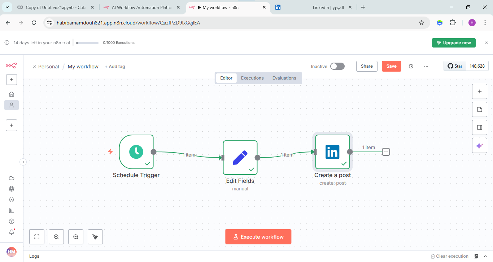
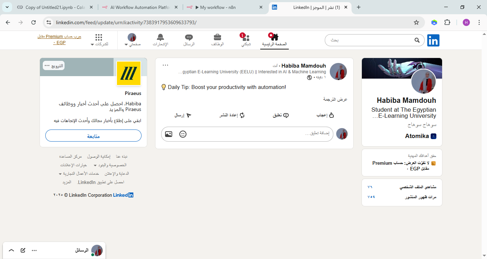

# 4. Social Media Post Scheduler

Posts a short "Daily Tip" on my LinkedIn profile every day at 10:00 AM (Cairo time).

## Flow

`Schedule Trigger` → `Edit Fields` → `LinkedIn`

- **Schedule Trigger**: every 1 day at 10am.
- **Edit Fields**: sets a field called `text` with the post content: "Daily Tip: Boost your productivity with automation!"
- **LinkedIn**: creates a post as a person, using `{{ $json.text }}` as the text.

## Setup

1. Import `workflow.json` and connect your LinkedIn account in n8n.
2. Choose your profile in the **Person Name or ID** field (`YOUR_LINKEDIN_PERSON_ID`).
3. Change the text in the Edit Fields node to whatever you want to post.
4. Activate the workflow. While testing you can use **Execute workflow** to post once.

## Result

Node settings: [Schedule Trigger](screenshots/schedule-trigger-node.png), [Edit Fields](screenshots/edit-fields-node.png), [LinkedIn](screenshots/linkedin-node.png)
